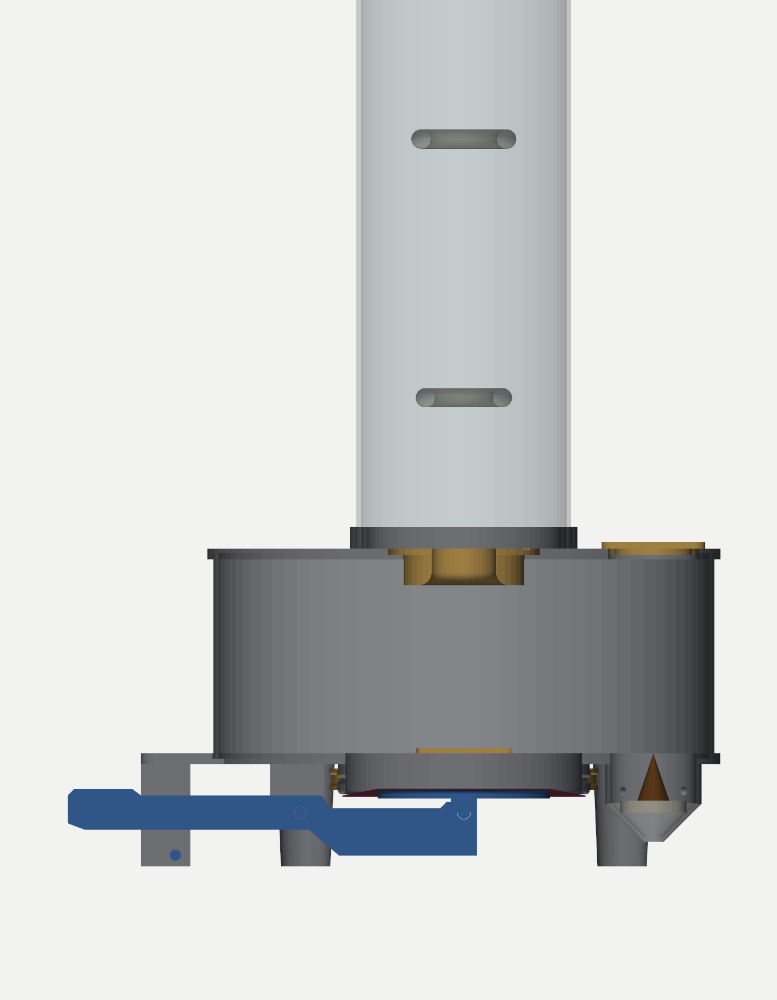
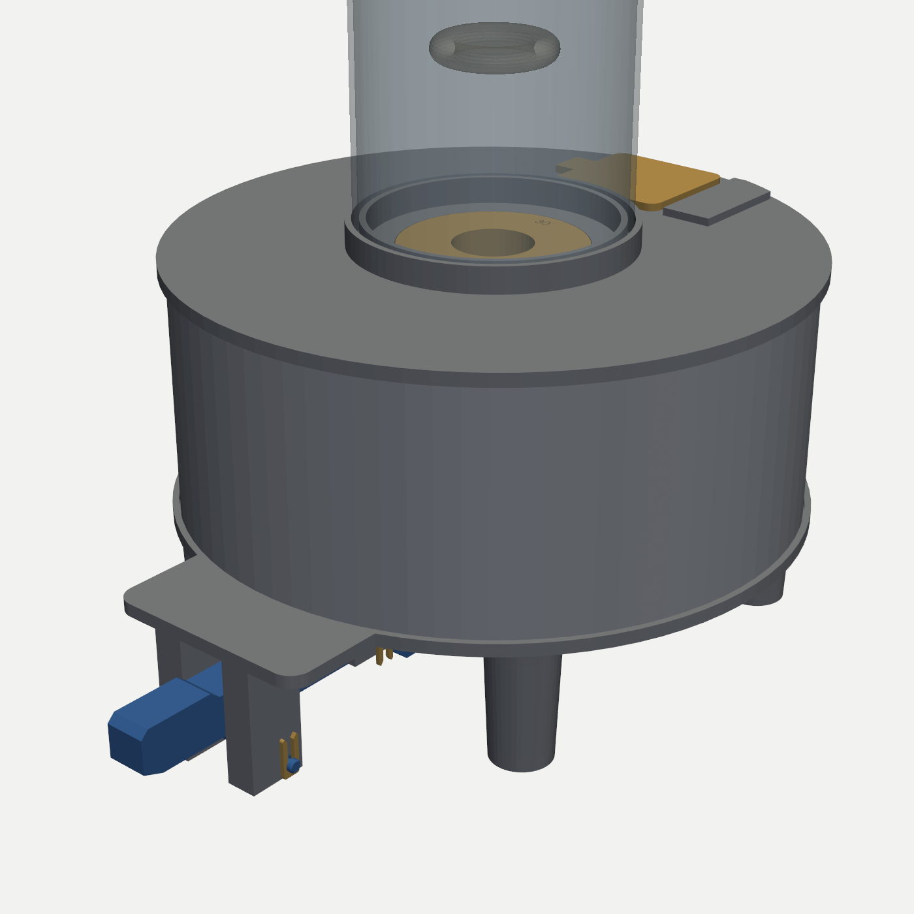
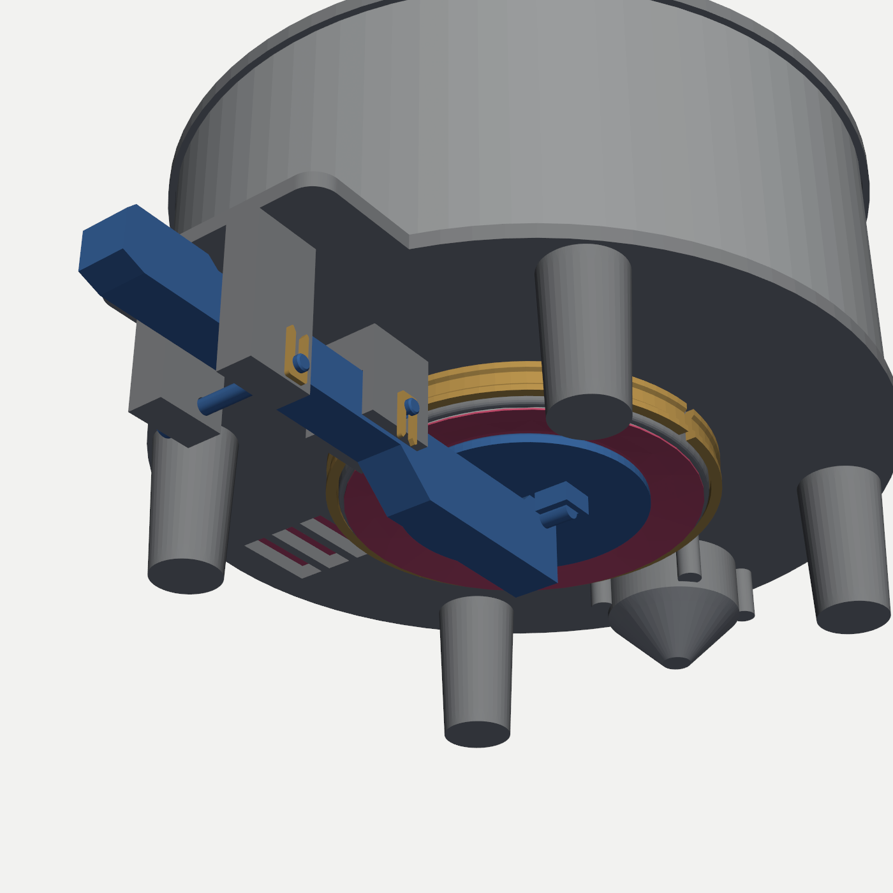

# Incense Vortex Ring

A hand-pumped smoke-ring generator for the same **100 mm OD × 2 mm acrylic tube** used by the
Hearth and Wind tornadoes. An incense cone fills a closed chamber with smoke. Pressing a
piano-key lever pushes a latex membrane up into the chamber, and the displaced air leaves
through a sharp-edged orifice under the tube. It rolls up into a vortex ring (a rolling torus)
that climbs the tube and floats out of the top. **No electronics.**

In the folio's epigraph, the Sun, Wind and Earth already name instruments I–III. This build
would be the fourth: *"the Moon its mother"*, the ring.



| | |
|---|---|
|  |  |

**Status:** designed and checked in CAD on 2026-10-16, then revised the same day after a
geometry review (see [Revision 2](#revision-2-after-the-geometry-review)). Not yet printed or lit.

## How it works

1. The cone sits in a **well** sunk below the chamber floor, off to one side, on a metal bottle
   cap. Its plume rises into the chamber, not straight up the tube, and its ash and heat stay
   away from the latex. The well opens **only into the chamber**: four small ducts in its wall
   bring chamber air from the floor down to the cone's base.
2. The chamber is sealed except for the orifice and the flap valve. That matters: the cone's
   heat turns chamber plus tube into a chimney, the same draft (~0.1–0.3 Pa) that drives the
   Hearth tornado. Any opening low in the chamber would feed a steady smoke stream up the tube
   between rings, carrying about as much smoke as the rings themselves.
3. **Press the key.** The pusher disc lifts the membrane. A full press, until the lever lands on
   its stop pin, moves it 12 mm and displaces **86 mL**.
4. The slug leaves through the orifice insert. Its **bellmouth inlet** lets the bore run full,
   and its **square exit edge** makes the flow separate exactly at the bore diameter, so the
   slug's length-to-diameter ratio is the one the sizing below assumes. It rolls into a ring
   about 1.2× the orifice diameter.
5. **Release.** The membrane springs back and the chamber refills:
   - On a brisk release, through the **flap valve**: a strip of nitrile glove lying flat on a
     grille in the chamber floor. Its own weight (~1.1 Pa) keeps it shut against the draft, and
     the push presses it down harder.
   - On a slow release, back through the orifice, which is harmless: the ring has already left.

## Sizing: why these numbers

| Orifice insert | Ring at birth | Ring / 96 mm bore | Full-press slug L/D |
|---|---|---|---|
| Ø25 | ~30 mm | 0.31 | 7.0, so **press about halfway** |
| **Ø30 (start here)** | ~36 mm | 0.38 | **4.0**, the ideal formation stroke |
| Ø35 | ~42 mm | 0.44 | 2.5 |
| Ø40 | ~48 mm | 0.50 | 1.7, fat and slow; rubs the wall near the top |

- **Keep the ring under about half the bore.** The tube wall acts like a mirror-image vortex that
  slows the ring (only ~11 % for the Ø30 ring). Rings also grow as they climb.
- **Press gently instead of tapping.** A smooth press over about 0.1–0.2 s gives rings that rise
  ~0.4 m/s and take about a second to climb the tube. A sharp jab fires them at ~3 m/s, so they're
  gone in a blink.
- **Smoke is the limiting resource.** Each ring uses ~60–90 mL of chamber air, about 10× what the
  cone produces per second. One ring every 3–5 s stays dense. Let the chamber fill for a minute,
  then fire a series.

## Parts

All STLs are exported in print orientation. PETG, 0.2 mm layers, 3–4 perimeters, 15 % infill,
**no supports** for any part.

| File | Qty | Size (mm) | Notes |
|---|---|---|---|
| `floor_plate.stl` | 1 | 238 × 269 × 53 | Prints top-face-down. Includes the membrane spigot, the cone well with its air ducts, the flap-valve grille, the lever cheeks, the two front posts and 4 feet. |
| `chamber_wall.stl` | 1 | Ø233 × 96 | Plain ring. |
| `lid.stl` | 1 | Ø238 × 15 | Tube collar (same groove as the Hearth base), orifice socket, hatch opening, hinge land. |
| `hatch.stl` | 1 | 59 × 48 × 6 | Lighting hatch over the well. |
| `orifice_25mm.stl` … `orifice_40mm.stl` | 1 each | Ø70 × 17 | Drop-in, size engraved on top. Square exit edge, bellmouth inlet. Print at least the Ø30. |
| `lever.stl` | 1 | 190 × 31 × 16 | Prints on its side so the layers carry the bending load. |
| `pusher_disc.stl` | 1 | Ø80 × 11 | Smooth face on the bed (it touches the latex). |
| `cross_rod.stl` | 1 | Ø6 × 36 | Slides through the lever tip; glue it there. |
| `pivot_pin.stl` | 1 | Ø5 × 31 | Slip fit through cheeks and lever, held by a pin clip. An M5 × 30 bolt and nut also works. |
| `stop_pin.stl` | 1 | Ø5 × 50 | Across the front posts, under the lever: it ends the stroke. An M5 × 50 bolt and nut is stronger if you press hard. |
| `pin_clip.stl` | **2** | 16 × 7 × 1.6 | Hairpin clips that snap into the pin grooves. |
| `membrane_clamp.stl` | 1 | Ø125 × 10 | Split collar. Its inner bead seats the latex in the spigot groove; a zip tie in its outer groove closes it. |
| `valve_clip.stl` | 1 | 44 × 7 | Pins the hinge edge of the film flap to the floor. |

## Bill of materials (non-printed)

- 100 mm OD × 2 mm clear acrylic tube, 393.7 mm (the existing one)
- **Membrane: one latex party balloon, 12″ (30 cm) or larger.** A 16–18″ balloon is easier to
  stretch. Use the balloon, not the glove, for the membrane:
  - It stays elastic. The membrane's spring-back is what returns the key, and nitrile creeps and
    stays stretched.
  - A glove opened flat is only ~110 mm wide. The Ø117 spigot plus the wrap needs ~145 mm.
- **One zip tie**, up to 4 mm wide, to close the membrane collar. A strong rubber band
  wrapped several times also works.
- **Nitrile glove:** a 50 × 46 mm piece from the back of the hand (single layer, no seam)
  becomes the flap-valve film. This is the right job for it: thin and light.
- **The 2 small nylon hinges → the lighting hatch** (see below), plus small screws to suit them
- Metal bottle cap, or 2–3 layers of aluminium foil (**required**: it's the heat shield under the
  cone)
- Aluminium foil tape, a ~60 mm square on the hatch and lid underside above the well (heat
  spreader). A strip around the inside of the well wall does no harm either.
- Optional: M5 × 30 and M5 × 50 bolts with nuts, in place of the printed pins

### Why the hinges moved from the flap valve to the hatch

A rigid hinged flap has to be lifted against its own weight. A ~2 g printed flap over the valve
port needs **~15 Pa** to open, plus hinge friction. Releasing the key produces only a few
pascals of suction at most, so a hinged flap would barely ever open. A glove film lying on the
grille weighs about 1 Pa: enough to stay shut against the cone's draft, light enough for a
brisk release to lift it.

The hinges are ideal for the **hatch**: gravity keeps it shut (chamber pulses are only a few Pa),
it flips 180° open to lie flat, and you can light or swap the cone without lifting the tube.

## Assembly

1. **Membrane.**
   - Cut the balloon's neck off about a third of the way down.
   - Stretch the dome over the spigot's rounded rim from below, and roll ~12 mm of it up the
     outside, past the groove.
   - Slide `membrane_clamp` up over it, chamfered end first; the split lets it open over the
     spigot. Its inner bead should sit in the groove.
   - Pull a zip tie tight in the collar's outer groove.
   - The membrane should be drum-tight and wrinkle-free.
2. **Lever.**
   - Push `cross_rod` through the lever tip so it sticks out equally (~10 mm) on each side, and
     glue it.
   - Rest the disc's two saddles on the rod ends, smooth face up.
   - Lift the lever with the disc straight up between the cheeks (its key arm runs between the
     two front posts) until the outer arm meets the stop bar; the disc presses ~2 mm into the
     membrane.
   - Push `pivot_pin` through cheek, lever and cheek from the left (head on the left), and slide
     a `pin_clip` sideways into the groove on the right until it snaps on.
   - Push `stop_pin` through the two front posts, under the lever, the same way, and clip it.
   - **Check:** the key rests up, and pressing it down until the lever lands on the stop pin
     lifts the disc 12 mm. The key end stays ~1 mm clear of the table.
   - Pin too tight: run a 5 mm drill through the holes.
   - To change the balloon later, pull both clips and pins, drop the lever out, cut the zip tie.
3. **Heat shield.** Drop the bottle cap (dish up) or foil disc into the well. The 45° funnel
   centres it.
4. **Flap valve.**
   - Cut the glove piece 50 × 46 mm.
   - Lay it flat on the chamber floor over the grille, one 46 mm edge on the two peg holes
     beside the grille's inner side.
   - Push the pegs of `valve_clip` through the film into the holes.
   - The film must lie flat and cover every slot with a few mm to spare, free to lift.
5. **Stack.** Set the wall ring in the floor groove, then seat the lid so the hatch sits
   **directly over the well**. Drop in the Ø30 orifice insert and set the tube in the collar
   groove.
6. **Hatch.**
   - Lay the hatch in its opening.
   - Surface-mount the hinge(s) across the 4 mm gap between the hatch and the raised land
     beside it, knuckle centred over the gap; the land is flush with the closed hatch for
     this. Drill pilot holes to suit the hinges.
   - Stick foil tape on the hatch underside.

Optional seal: if rings feel weak, a thin smear of petroleum jelly in the wall-ring grooves stops
the joint leaks (normally a few percent).

## Use

1. Light the cone outside the base and wait for a steady smoke ribbon.
2. Flip the hatch open, lower the cone onto the cap with tweezers, and close the hatch.
3. Wait 30–60 s for the chamber to fill.
4. Press the key **smoothly**, like a slow piano note, down to its stop. Pause 3–5 s between
   rings. Let the key up briskly to refill through the flap valve with fresh air, or slowly to
   refill back through the orifice; both work.
5. A dark backdrop and a light from the side make faint rings glow. This matters more than
   anything else.
6. Try two quick presses: when the rings are close in strength, the second can catch the first and
   pass through it ("leapfrogging").
7. Lift the instrument by the floor plate, never by the tube: the lid only sits on the wall.

## Tuning

- **Rings weak or ragged:** press more smoothly; try the Ø35 insert; seal the wall grooves.
- **Cone keeps going out:** pump a few strokes, since each refill brings fresh air. Check that
  ash isn't blocking the four duct holes around the well's rim.
- **Rings too fast:** press slower or not as deep. **Too lazy:** press faster, or use a smaller
  orifice.
- **Smoke between rings:** a faint wisp out of the orifice is normal: warm smoke trading places
  with cool air through the opening itself, ~4–6 mL/s. A steady stream means air is getting in
  low down. Check that the film lies flat on the grille and that the wall grooves seal.
- Geometry is parametric in `vortex_ring_base.py`: orifice sizes, stroke, chamber height, lever
  ratio, clearances.

## Safety and care

- **Never leave a burning cone unattended.** All of this is PETG, which softens near 80 °C. The
  metal heat shield is not optional.
- The lid sits ~90 mm above the ember. Plume estimates put it around 50–70 °C at the lid for a
  normal cone. That's why the chamber is tall and why the foil spreader is there; don't shorten
  `CH_H` without a reason.
- The cone burns 12–13 mm from the plastic well wall over its whole height. Watch the well on the
  first few burns; if it softens, line it with foil tape.
- Incense tar coats everything: the latex, and the film flap, which can turn sticky. Wash PETG,
  film and acrylic with isopropyl alcohol. Replace the balloon when it loses snap or turns tacky.
- Never inhale from the orifice or valve.

## Revision 2: after the geometry review

The first version (also 2026-10-16) printed cleanly, but a review of the airflow and the fits
found six problems. All six are fixed in the generator:

| # | Problem in the first version | Change |
|---|---|---|
| 1 | The well vented to the room (4 bleed holes and an apex hole) and the valve film hung vertically, opening at ~0 Pa. With the orifice and tube above, that's a chimney: an estimated 16–31 mL/s steady smoke stream, vs 21.5 mL/s carried by rings fired every 4 s. And 7–12 % of every push escaped back out through the well. The old claim that "the cone needs only ~6 mL/s, so no smoke streams up the tube" was wrong: the heat sets the draft, not the cone's appetite. | Well sealed to the room, fed by 4 ducts from the chamber floor. The valve became a film lying flat on a floor grille, held shut by its own weight (~1.1 Pa) against the draft. |
| 2 | The orifice exit had a 45° countersink, making a blunt 135° edge. On a gentle press, the flow could follow the bevel and separate at Ø36 instead of Ø30. The inlet had only a 2 mm chamfer, so the jet necked down inside the bore. Both moved the real L/D away from the 4.0 the sizing assumes. | Square exit flush with the top face, 6 mm bellmouth inlet. Same print orientation. |
| 3 | The front feet sat at x = ±32 under the tongue, so the nearest tipping edge was 67 mm from the tube axis. | Four tapered feet out at the rim plus the front posts: **85 mm** (+27 %). |
| 4 | The wedge clamp ring held the membrane by friction alone: 0.15 mm per side over the spigot for ~0.2 mm of latex, about the size of normal print error. | Split collar closed by a zip tie, with a bead that seats the latex in a 1.5 mm spigot groove. Spigot wall 2.5 → 3.5 mm. |
| 5 | The pivot pin was a press fit, but the lever has to come out at every balloon change. The cross rod was Ø6 in a Ø6.0 hole, which is an interference fit once printed. | Slip-fit pins (Ø5.3 holes) with printed hairpin clips; rod hole Ø6.2, glued. |
| 6 | The stroke ended when the key hit the table. At a table edge or on a cloth, the key over-travels until the lever nose hits the disc: a 21.6 mm stroke, L/D 7.3 on the Ø30. | Two posts under the tongue carry a stop pin under the lever. The key end is chamfered to stay 1.3 mm off the table. |

Still open, lower priority: the disc's rounded top edge sits on the bed (a 45° chamfer would
print cleaner), and the lid isn't locked to the wall.

## Validation (2026-10-16, revision 2)

`python vortex_ring_base.py` builds every part, then checks the following:

- **Meshes:** all 16 STLs are watertight and single-body, and fit the 320 mm bed (largest: the
  269 mm floor plate). `lib/validate_mesh.py` (pymeshlab) reports **PRINT-READY** for all, with
  no self-intersections.
- **Overhangs:** an audit of the print orientations finds nothing past 45° except short bridges:
  the 3.2 mm groove roofs, the ≤ 9 mm hole and slot roofs, the Ø8 well floor, and the 0.8 mm
  pin-groove ledges.
- **Mechanism** at rest, half and full press:
  - The lever clears the floor parts by 0.4 mm (at the cheeks), the collar by 4.3 mm and the
    disc by 0.5 mm. The rod rides its saddle groove with 0.3 mm.
  - The lever meets the stop pin exactly at the 12 mm disc stroke, with the key end 1.26 mm
    above the table.
- **Assembly:** no pair among the 14 assembled parts overlaps. The only zero gaps are the
  intended seats: wall in its grooves, insert flange, hatch, rest stop bar, stop pin at full
  press, valve clip on the floor.
- **Stability:** the support polygon's nearest edge is 85.0 mm from the tube axis.

Regenerate from this directory:

```bash
python vortex_ring_base.py
```

(`--no-preview` skips the renders.)
