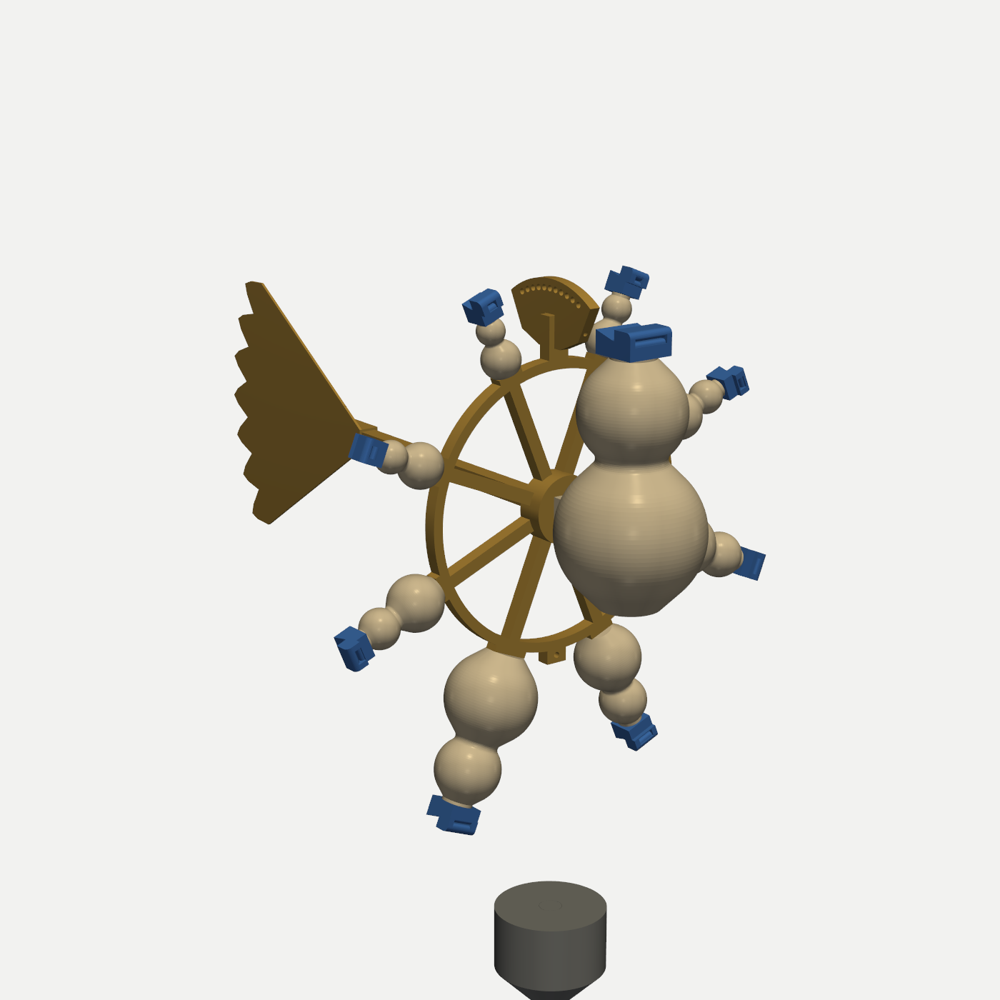
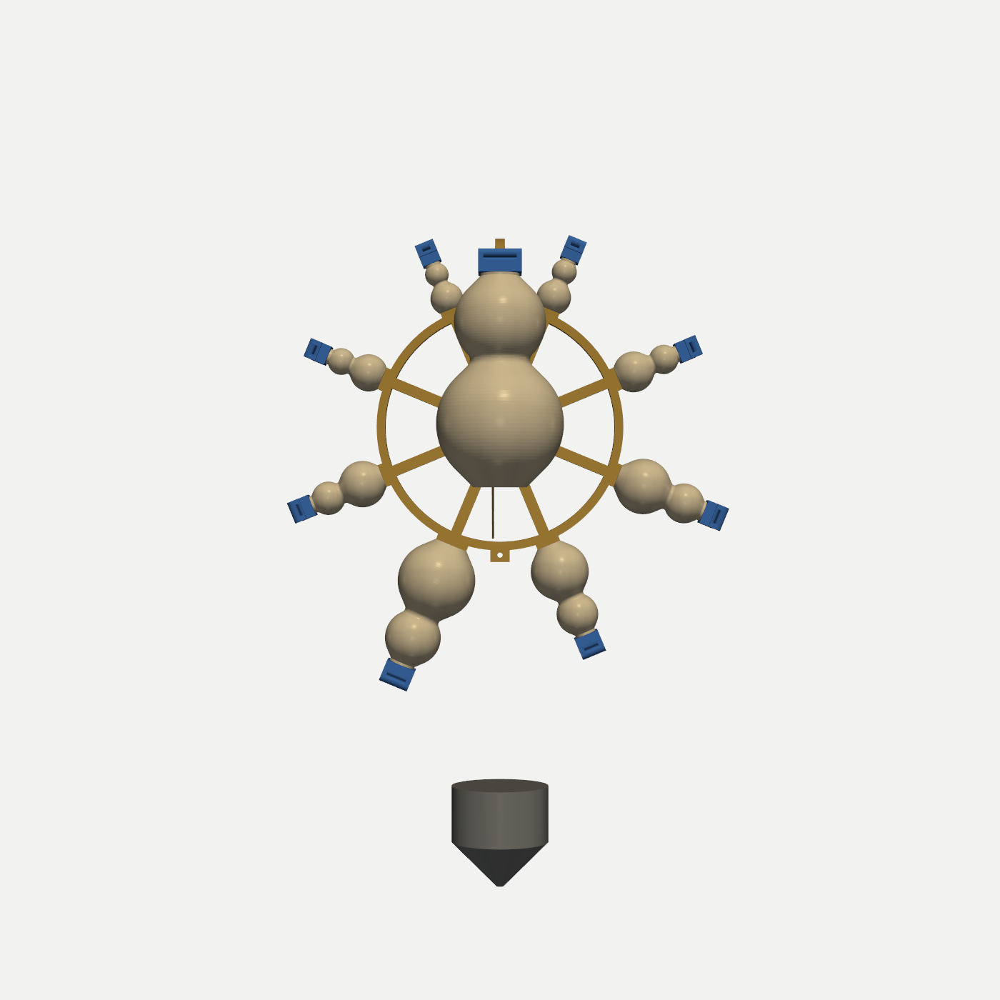
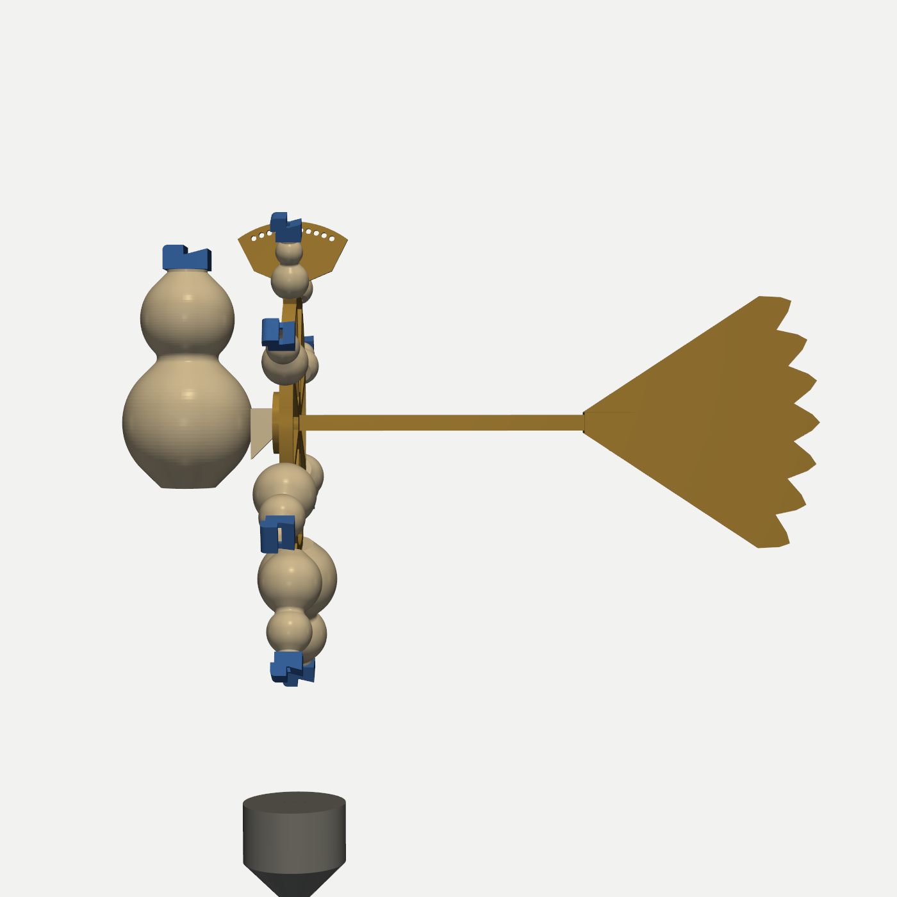
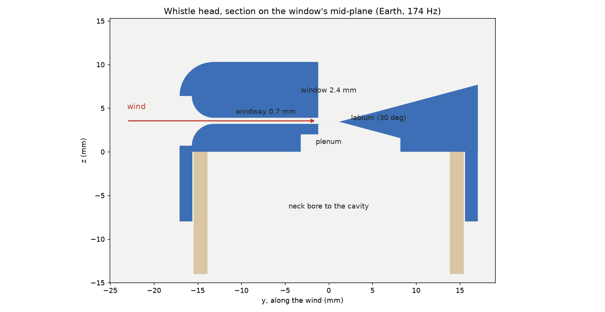

# The Hymn of the Ogdoad — a wind-blown Helmholtz chandelier

Nine pigeon-whistle (*geling*) voices, tuned to the nine Solfeggio tones and hung as a geocentric
cosmos. **Earth** (174 Hz) is the big gourd at the centre. A wheel carries the seven planetary
spheres in the Chaldean order the Hermetic *Poimandres* climbs (Moon, Mercury, Venus, Sun, Mars,
Jupiter, Saturn), and at the top the eighth sphere, the **Ogdoad** (963 Hz). A dove-tail vane keeps
every intake facing the wind. A crown takes the swivel, and a sand-filled plumb-bob hangs below as
ballast.

Every voice shares one whistle cut-up (window W = 2.4 mm), so each speaks in its own band of wind
speed, in order of pitch. A breath of air wakes Earth, and only a fresh breeze reaches the Ogdoad.

Exposé page: [web/hymn-of-the-ogdoad.html](../../web/hymn-of-the-ogdoad.html), which is staged in `site/`.

| | |
|---|---|
|  |  |
|  |  |

**Status:** designed and checked in CAD on 2026-10-20. Pitch re-solved the same day after a tone-math
review (see below) and verified by 3-D FEM: all nine within −4 to +2 cents. Not yet printed or heard.

## How a voice works

Each gourd is a Helmholtz cavity, and the whistle head glued to its neck holds the mouth. Wind enters a
bellmouth and leaves a 0.7 mm windway as a flat jet. The jet crosses the 2.4 mm window (the
cavity's mouth) and splits on a 30° labium. The jet's waving pumps air in and out of the window
at the cavity's resonance. The head's tall block shelters the window, so the jet crosses slower air
and keeps the shear that makes it wave.

- **Pitch:** the gourd's interior is solved as a 1-D acoustic line, made of plane-wave slices of the
  revolved inner profile closed by the rigid floor. The head's plenum adds a compliance and the window
  adds a mass. The window's end correction is the radiation mass of the actual W × b slit
  (closed-form rectangle self-potential), times a factor `K_END(b) = 0.960 + 0.0375 ln(b/10 mm)`
  fitted to the FEM.
- **Pitch check:** `fem_check.py` meshes the real air (gourd, bore, plenum, window and a sphere of open
  air) and solves the 3-D Helmholtz eigenproblem. Two outer radii are extrapolated to free air, and the
  result is corrected for the volume that straight-sided tets cut off the curved walls.
- **Wind bands (model):** jet speed U = 0.85 × wind. A voice speaks while the jet Strouhal number
  St = f·W/U is in 0.10–0.40, best at 0.22 (jet-delay criterion; recorder and ocarina data put the
  best response at 0.15–0.25). With W fixed, a voice's band scales with its pitch.

## The nine voices

| # | Voice | Tone | Gourd Ø × H (mm) | Cavity (cm³) | Window b (mm) | Wind on / best / overblow (m/s) | Angle on wheel | PETG |
|---|---|---|---|---|---|---|---|---|
| 0 | Earth | 174 Hz | 100 × 176 | 629.9 | 26.1 | 1.2 / 2.2 / 4.9 | centre, in front of the hub | 161 g |
| 1 | Moon | 285 Hz | 64 × 115 | 155.4 | 16.6 | 2.0 / 3.7 / 8.1 | 247.5° (left) | 58 g |
| 2 | Mercury · UT | 396 Hz | 48 × 88 | 61.2 | 12.4 | 2.8 / 5.1 / 11.2 | 292.5° (right) | 32 g |
| 3 | Venus · RE | 417 Hz | 46 × 84 | 52.9 | 11.9 | 2.9 / 5.3 / 11.8 | 337.5° (right) | 30 g |
| 4 | Sun · MI | 528 Hz | 38 × 70 | 27.9 | 10.0 | 3.7 / 6.8 / 14.9 | 202.5° (left) | 24 g |
| 5 | Mars · FA | 639 Hz | 34 × 61 | 16.9 | 8.8 | 4.5 / 8.2 / 18.0 | 22.5° (right) | 20 g |
| 6 | Jupiter · SOL | 741 Hz | 31 × 56 | 11.7 | 8.0 | 5.2 / 9.5 / 20.9 | 157.5° (left) | 18 g |
| 7 | Saturn · LA | 852 Hz | 29 × 52 | 8.7 | 7.5 | 6.0 / 10.9 / 24.1 | 67.5° (right) | 16 g |
| 8 | Ogdoad · SI | 963 Hz | 27 × 49 | 6.8 | 7.0 | 6.8 / 12.4 / 27.2 | 112.5° (left) | 15 g |

Angles are measured counter-clockwise from +x, seen from upwind. The rays climb in four tiers. Each
tier's pair is split left/right to balance the wheel, so the climb zig-zags across the axis
(the caduceus).

**One known clash:** 396 and 417 Hz beat at 21 Hz, the roughest possible spacing for pure tones.
They are also neighbours on the wind ladder. Every other pair is mild, because pure sines only clash
when they are close in pitch.

## Checks

- **Pitch (`fem_check.py`, 3-D FEM of the built air):**

  | Voice | Earth | Moon | Mercury | Venus | Sun | Mars | Jupiter | Saturn | Ogdoad |
  |---|---|---|---|---|---|---|---|---|---|
  | FEM, Hz | 174.0 | 285.3 | 396.0 | 416.9 | 527.5 | 638.0 | 739.4 | 850.8 | 962.7 |
  | vs target | 0 ¢ | +2 ¢ | 0 ¢ | 0 ¢ | −2 ¢ | −3 ¢ | −4 ¢ | −2 ¢ | −1 ¢ |

- **CAD (`python chandelier.py`):**
  - Every built cavity solid matches its design volume. This is a volume check, not a pitch check.
  - Mating parts do not interpenetrate, and non-mating parts stay at least 3 mm apart.
  - All 24 STLs are watertight and single-bodied, fit the 320 mm bed, and pass `lib/validate_mesh.py`.
  - Printed mass is 699 g, with the centre of mass at (−0.9, +15.5, −2.5) mm. Hang from the crown hole
    at y = +18 mm (toward the vane).
  - Assembled size is about 363 mm wide × 542 mm deep × 536 mm tall, including the bob on a 190 mm cord.
- **Page:** `window.__selfTest()` ports the line model to JavaScript and reproduces all nine pitches to
  0.002 cents (56/56 pass).

## Tone-math review (2026-10-20)

The first design used a lumped model: two bulbs coupled through the waist, and a window mass with a
baffled-slit end correction. That model counted the 10–12 mm **neck bore** between the gourd and the
head only as volume. The bore's air moves with the window's plug and is a large extra mass. On the
small voices it is as much as 60 % of the window's own. FEM of those first gourds:

| | Earth | Moon | Sun | Ogdoad |
|---|---|---|---|---|
| target | 174 | 285 | 528 | 963 |
| FEM, as first built | 150.1 | 240.4 | 427.9 | 761.3 |
| error | −256 ¢ | −295 ¢ | −364 ¢ | −407 ¢ |

The first CAD check reported each voice "within 0.1 cents". That check only compared built volume
with designed volume, so it could never see a model error. It is now labelled a volume check.

The fix is the 1-D line model above. Before calibration it already agrees with the FEM within 18
cents, and the fitted end-correction factor brings it within 1.4 cents. The re-solved gourds are about
10 % smaller across. The naive one-volume Helmholtz formula would put these final gourds 21–31 %
(4–5 semitones) sharp.

Also reviewed, and fine:
- c ∝ √T: −45 ¢ at 5 °C and +43 ¢ at 35 °C.
- Wall compliance is under 0.2 % of the air's.
- The Plomp–Levelt roughness, with 396/417 the only rough pair.
- The Strouhal band edges, which remain a model.

FEM convergence:
- Window-edge refinement changes the result by under 0.2 Hz.
- After the curved-wall volume correction, two bulk mesh densities agree within 4 cents.
- The outer sphere radius moves the result by about 1 Hz before extrapolation.

Sensitivities, for tuning and tolerances:

| Change | Pitch shift |
|---|---|
| 1 % less cavity volume | +9 to +10 ¢ |
| 1 % narrower window | −3 to −4 ¢ |
| Neck bore printed 0.15 mm undersize in radius | −12 ¢ on the small voices (−3 ¢ on Earth) |

## Print

| Part | Orientation | Notes |
|---|---|---|
| 9 gourds | upright | Supports not needed: every surface, inside and out, is within 45° of vertical. 3 perimeters. **Must be airtight.** |
| 9 heads | on their side, D-flat up | 0.4 mm nozzle, 0.12 mm layers, slow outer walls: keep the 0.7 mm windway open and the labium sharp. |
| wheel | rear face down | Hub, 8 spokes, ring, offset foot pegs, crown and pendant lugs. |
| crown, fin, stopper | flat or upright | As exported. |
| vane boom | lying | 274 mm long. |
| plumb-bob | flat top down, point up | Fill with dry sand (~0.4 kg) or steel shot (~1.1 kg). |

Hardware: one M3×20 bolt and nut, a ball-bearing fishing swivel and cord, a steel split ring for the
bob, and epoxy or gap-filling CA.

## Assemble, tune, hang

1. Test and tune each voice **before** gluing: blow across the intake (hair-dryer on cool, or a fan) and
   read a tuner app.
   - Flat: drop plasticine or glass beads into the gourd. 1 % less volume raises the pitch about 9 cents.
     Check the neck bore first: printed 0.15 mm undersize, it costs the small voices about 12 cents.
   - Sharp: tape across one end of the window. 1 % less width lowers the pitch only about 4 cents.
   - Pitch follows air temperature: about −45 cents at 5 °C and +43 cents at 35 °C, relative to 20 °C.
2. Glue the heads on. The D-flat only lets the intake face upwind, and the glue seals the joint.
3. Glue the planets onto the wheel's foot pegs. The pegs are offset, so each gourd goes on only one way.
4. Push Earth's rear boss onto the hub's front peg, the boom into the hub, and the fin onto the boom.
5. Bolt the crown over the top lug and hang the swivel from the +18 mm hole. Move one hole either way
   until the wheel hangs plumb.
6. Hang the filled bob about 190 mm below the bottom lug.
7. Hang the chandelier in open air, ideally under an eave: the upward-facing mouths collect rain.

**Field test:** note each voice's start and stop wind speed with a pocket anemometer. Those numbers
replace the model's ST_ON / ST_OPT / ST_OFF.

## Files

- `voices.py` — acoustic design: gourd profiles, exact volumes, end corrections, 1-D line pitch
  solve, wind bands, roughness. Writes `voices.json`.
- `fem_check.py` — independent 3-D FEM pitch check (gmsh + scikit-fem, P2 tets, pressure-release
  sphere extrapolated to free air): `python fem_check.py Earth Ogdoad ...`, about 1 minute per voice.
- `chandelier.py` — build123d CAD for every part, cavity re-measurement, layout and balance,
  assembly clearance checks, STL export (`stl/`), previews. `--quick` skips the slow checks and
  `--no-preview` skips the renders.
- `sync_page.py` — injects `voices.json` into the web page and stages the page, previews and STL zip
  in `site/`.

Parametric: change `W_CUT`, `BETA`, `RF_MIN` or the head constants, then run `chandelier.py` followed
by `sync_page.py`.
