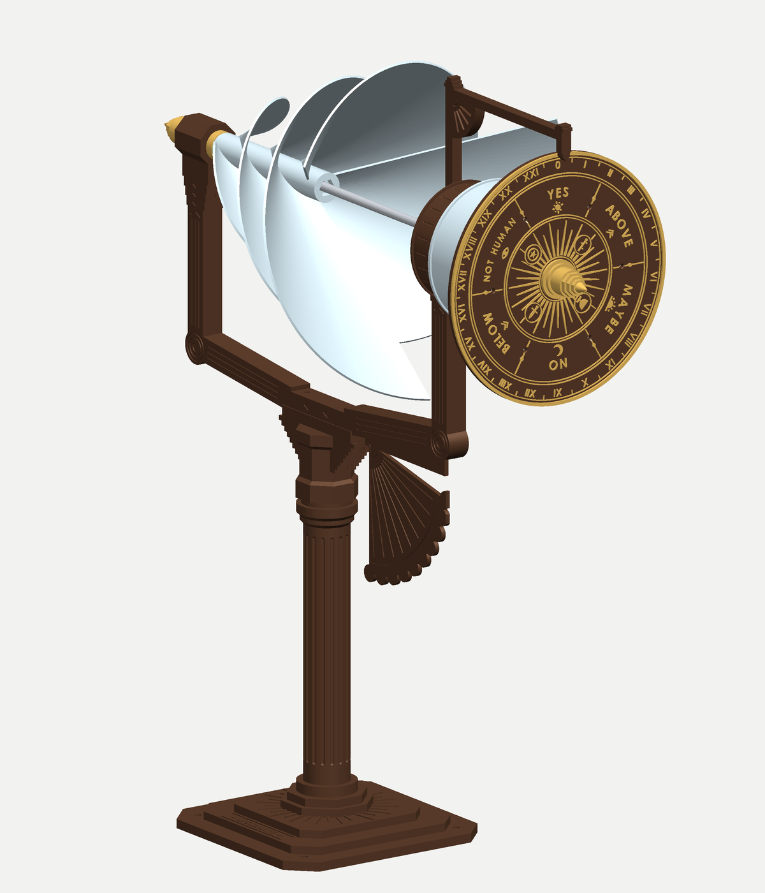
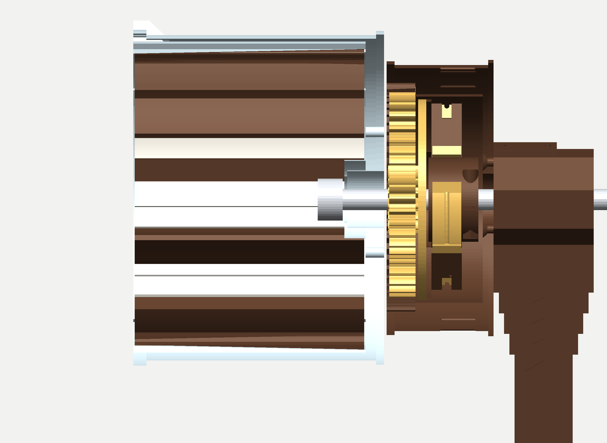
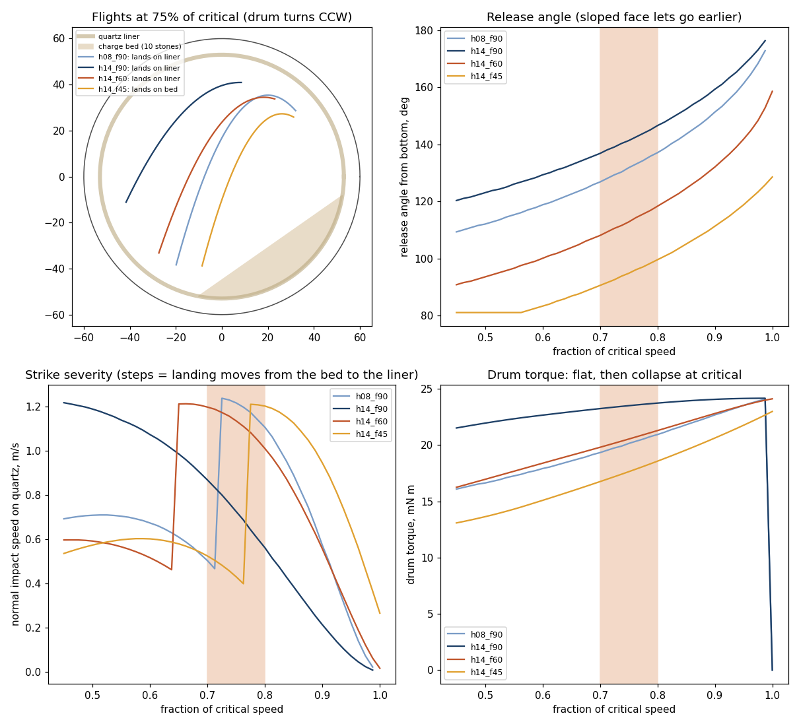
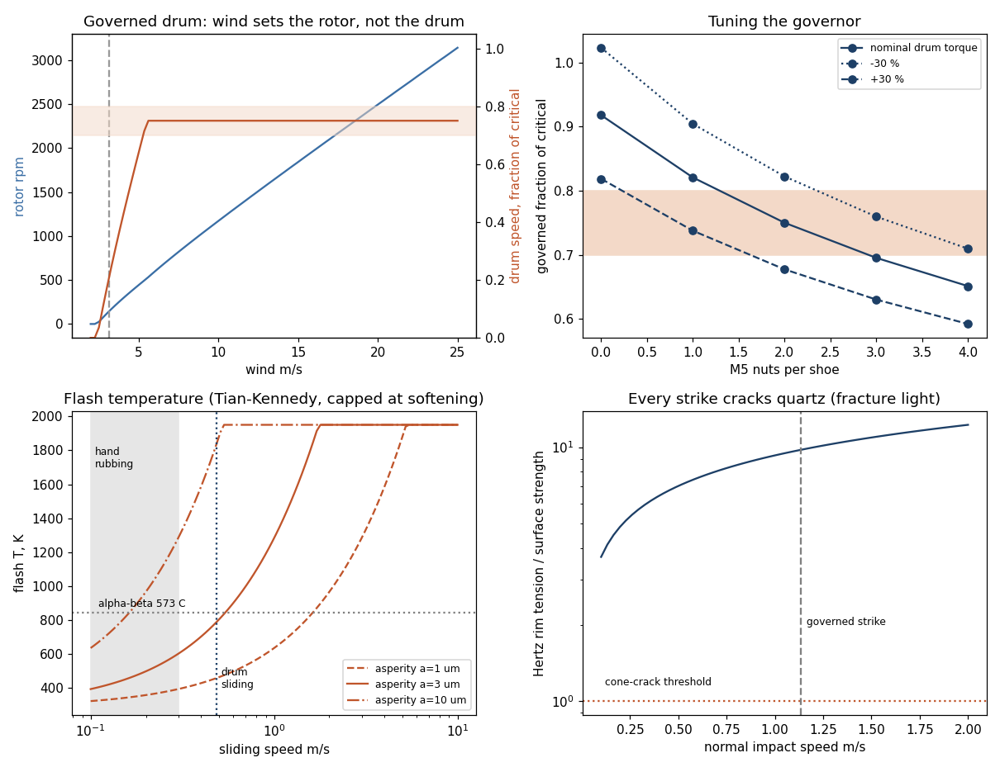
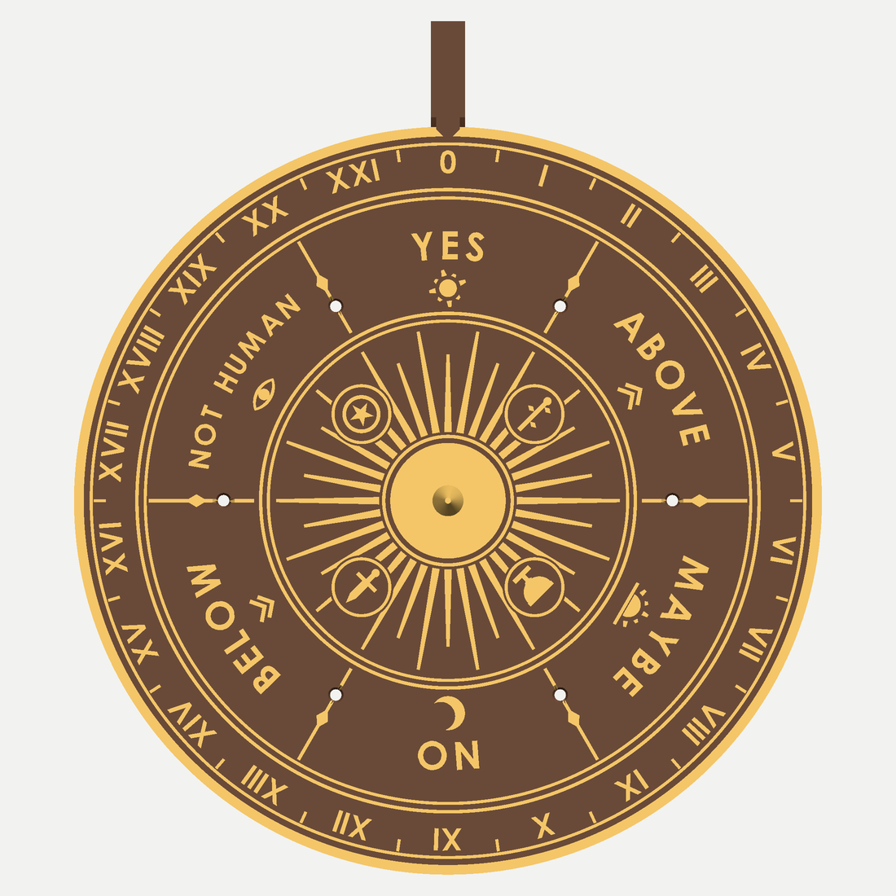

# Quartz Flash Windscrew

A desk-mounted Archimedes windscrew for a windy ridge. Through a governed 4.8:1 gearbox it
turns a clear, quartz-lined drum of loose stones at 75% of critical speed, so the stones fly
across and strike quartz hard enough to flash. The drum's lid is a communication disc that comes
to rest under a pointer when the wind drops: YES · ABOVE · MAYBE · NO · BELOW · NOT HUMAN. The
tarot's 22 Major Arcana, 0–XXI, run round the rim, and the four suits sit at the centre.

It is styled as if it came out of 1926: a scientific instrument from the year after the Paris
*Exposition des Arts Décoratifs*, with the spirit-board craze of the 1920s on its dial.

| file | what it does |
|---|---|
| `windscrew.py` | parametric generator → `stl/*.stl` (print orientation), `assembly.npz`, part table, clearance check (fails the build if anything touches) |
| `deco_motifs.py` | Art Deco motif library: sunbursts, rays, chevrons, lozenges, clipped-corner plans, Egyptian eye, sun and moon, curved and straight type |
| `tumbler.py` | lifter-drum model: release, flight, landing, impact speed, drum torque → `tumbler.png` |
| `gears.py` | involute gears by the generating method, plus the planetary mesh check |
| `physics.py` | rotor, gearbox, governor and flash physics → `physics.png` |
| `preview.py` | `preview_*.png` renders |

Run from this directory: `python tumbler.py && python physics.py && python windscrew.py && python preview.py`.

## How quartz makes light when it is struck

Mechanoluminescence covers any light made by mechanical action. *Triboluminescence* is light
from rubbing or crushing; *fractoluminescence* is light from fracture itself. Quartz does both,
and the light is not the stone getting hot as a whole. The bulk stays cool. In the windscrew
two different processes are at work:

1. **Fracture (non-thermal).** A crack opening across quartz leaves the two new faces with
   opposite surface charges. The field across the gap is strong enough to break down the air,
   so the crack lights up as a microscopic gas discharge. Nitrogen's ultraviolet-to-violet
   lines are the standard signature of fracture light in air. Defect centres in the quartz
   lattice add their own luminescence, which is excited by electrons and by the discharge.
   Piezoelectricity is not needed: fused silica glass does this too.
2. **Sliding hot spots (thermal, at micron scale).** When quartz slides on quartz, the real
   contact is a few asperities, each a few µm across. Friction heat lands on them faster
   than quartz can conduct it away. On these spots the Tian–Kennedy flash-temperature model
   reaches the silica softening ceiling (~1950 K) once sliding passes about **1–2 m/s**.
   At **hand-rubbing speed (~0.2 m/s)** it only reaches 500–970 K. On the way up the spot
   crosses the α–β inversion at 573 °C, and the volume jump there cracks the surface, which
   feeds channel 1.

The literature has not settled how much of the orange glow from rubbed quartz is thermal.
Chapman and Walton (*J. Appl. Phys.* 54, 5961, 1983) and Chapman's 1981 thesis compared
continuum spectra with blackbody curves. Other work attributes a 300–600 nm band to
triboelectric gas discharge. `physics.py` makes the thermal question testable instead of
assuming an answer. **Clear quartz is transparent**, so a micron-thick hot skin of it is a very
poor emitter. To clear the Hecht–Shlaer–Pirenne threshold (54–148 photons at the cornea) from
30 cm, the hot skin needs a visible emissivity of about **6×10⁻⁴**. That works out to an
absorption of about **2 /cm**. Clear rock crystal does not absorb that much. Milky quartz,
iron-stained quartz or skins carrying wear debris plausibly do.

**An experiment you can do with your own stones:** load clear crystal, then milky quartz, then
iron-stained quartz, and compare them on a dark night. If the clear stones show only blue-violet
crackle and the stained ones glow orange, the thermal channel is real and depends on absorption.

## The tumbler: a lifter drum at a governed speed

The tumbler follows three rules from ball-mill practice.

1. **A round shell with replaceable straight lifter ribs.** The ribs pick the stones up and let
   them go, so stones don't get trapped in pockets.
2. **Speed tuned for airborne rocks, not maximum rpm.** There are three regimes: cascading
   (stones roll, giving rubbing and compression), cataracting (stones leave the wall and fly
   across, giving hard impacts) and centrifuging (stones ride round the wall and nothing
   happens).
3. **Room to fall.** A sparse charge gives each stone a long flight and concentrates force in
   few contacts. Severity per strike, strikes per minute and breakage per joule are separate
   objectives, and they don't share one optimum.

`tumbler.py` turns those rules into numbers. It models each rib's release angle with friction
and Coriolis forces, the slide to the rib tip, the free flight, and where the stone lands: on
the charge bed, on the liner or on bare plastic. It also gives the impact speed and the drum's
torque.

What it showed, and what the build does about it:

- **The screw spins far too fast for a drum.** A Ø120 mm drum reaches critical speed at
  144 rpm, so 75% is 108 rpm. Unloaded, the screw runs 600–3100 rpm. A **4.8:1 printed
  planetary** sits between the shaft and the drum: the sun is driven, the ring is fixed in the
  housing, and the carrier is the drum's inboard plate.
- **A slip clutch alone cannot hold the speed.** Drum torque is nearly flat, about 17–24 mN·m
  from 50% to 95% of critical, because every stone is lifted close to the top either way. Then
  it collapses at critical. A torque-limited clutch would have about a 3% speed window. So the
  drive goes through a **centrifugal governor**, the kind used on 1920s gramophones, built as
  an inverse centrifugal clutch:
  - Three shoes on the sun's cage are held onto a hub on the shaft by an O-ring and drive the
    sun by friction.
  - As the sun speeds up, the shoes fling outward and grip less, until the torque they pass
    equals the drum's load.
  - The sun settles at ω² = (F − T/3μr_hub)/(m·r_shoe), and the wind no longer appears in that
    equation.
  - **You tune it by adding M5 nuts to the shoes.**
- **Most flights miss the other stones.** With a sparse charge the bed sits low on the rising
  side, while the flights land 20–110° round on the far wall. Quartz landing on PETG gives no
  flash. So the drum is lined with **quartz liner tiles**: twelve tiles on dovetail rails, faced
  with chips broken from your stones and set in epoxy. Every landing is then quartz on quartz.
  The ribs slide onto rails on the tiles, so you glue the chips once and swap ribs freely, as
  mill liners carry their lifter bars.
- **A through-axle catches the flights.** At 60–80% of critical the flights cross close to the
  drum's centre, and a central tube or rod intercepts them. So the drum has no through-axle. It
  hangs on two 608s in a hub at its inboard end, and the shaft stops there. The dial bolts on as
  the drum's outboard lid, so it now turns with the drum and still comes to rest under the
  pointer.
- **Rib face angle and speed must be paired.** Each rib peaks at about 1.2 m/s normal impact
  on quartz, but at a different speed:

  | rib (height above the quartz, face) | best fraction of critical | release angle at 75% |
  |---|---|---|
  | `h08_f90` (8 mm, radial face) | 75–80% | 132° |
  | `h14_f90` (14 mm, radial face) | 50–65% | 141° |
  | `h14_f60` (14 mm, 60° face) **default** | 65–80% | 113° |
  | `h14_f45` (14 mm, 45° face) | 80–85% | 95° |

  A steep face holds stones longer and throws them late, so it wants a lower speed. A sloped
  face lets go early, so it wants a higher one. The default pairing, `h14_f60` at 75%, sits in
  the 70–80% band from your notes. Swap ribs and nuts together.
- **Fill.** With 10 stones of 20 mm the bulk fill is 9.7% of the drum, and severity does not
  change with fill until the bed reaches the landing zone (above about 25%). The strike rate
  rises with the stone count until each rib carries 3 stones, at about 12 stones and 32
  strikes/s. Beyond that, extra stones only cushion. Start with 10–12.

## Numbers (`physics.py`)

| wind m/s | rotor rpm | drum rpm | fraction of critical | governed | strikes/s | normal strike on quartz m/s |
|---:|---:|---:|---:|---|---:|---:|
| 4 | 287 | 60 | 0.41 | no | 15 | 0.59 |
| 5 | 441 | 92 | 0.64 | no | 23 | 0.46 |
| 6 | 594 | 108 | 0.75 | yes | 27 | 1.14 |
| 10 | 1171 | 108 | 0.75 | yes | 27 | 1.14 |
| 15 | 1842 | 108 | 0.75 | yes | 27 | 1.14 |
| 25 | 3142 | 108 | 0.75 | yes | 27 | 1.14 |

**Governor tuning** (`h14_f60`, 10 stones; the O-ring presses each shoe in with about 0.9 N,
which takes a band tension of about 0.5 N):

| M5 nuts per shoe | 0 | 1 | 2 | 3 | 4 |
|---|---:|---:|---:|---:|---:|
| drum rpm | 132 | 118 | **108** | 100 | 94 |
| fraction of critical | 0.92 | 0.82 | **0.75** | 0.70 | 0.65 |
| at −30% / +30% drum torque | 1.02 / 0.82 | 0.90 / 0.74 | 0.82 / 0.68 | 0.76 / 0.63 | 0.71 / 0.59 |

- **Above about 6 m/s the drum runs at one speed in every wind.** Below that the shoes grip
  fully, and the drum turns at the screw's speed divided by 4.8. Cut-in is 3.1 m/s. The shoes
  dissipate under 2 W at 25 m/s.
- **Don't run with no nuts.** A light charge would then push the drum past critical, and the
  stones would centrifuge.
- **Every governed strike exceeds the Hertz cone-crack threshold by about 10×**: 1.14 m/s
  normal, about 670 N peak, p₀ = 2.4 GPa. So each strike chips quartz, and that fracture is
  where the light comes from. The stones and liner chips wear; expect grit, and top up both.
- **The drum trades heat for fracture.** Sliding on the liner is only about 0.5 m/s under about
  0.2 N. Asperity flash temperatures reach 790–1840 K, but the real contact area is too small
  for a visible thermal glow at any emissivity. So in this build the flashes come from fracture,
  and the clear-versus-milky experiment above will mostly test the fracture channel.
- **The screw is lightly loaded now.** The governor slips and passes only about 7 mN·m, so the
  screw runs near runaway: about 3100 rpm at 25 m/s. Blade stress at that speed is about
  3 MPa, which is fine for PETG, but balance the rotor on the rod before fitting it, and tie it
  off in gales.

**Assumptions and uncertainties:**
- **Rotor.** Ct(λ) = 0.2 (1 − λ/2) gives Cp_max = 0.10. That is conservative for a 300 mm
  Liam-type rotor; independent tests of the full-size rotor report 0.1–0.2.
- **Lifter model.** It treats each stone as a point mass on a quasi-static rib face, with
  μ = 0.35 for quartz on PETG, a bed tilted 35°, and 1–3 stones carried per rib. Collisions in
  flight between stones are ignored.
- **Governor.** μ = 0.4 for cork on PETG, a 1.5 mm cork pad, an 8 g shoe and 1.2 g M5 nuts. The
  O-ring force is the most uncertain number, which is exactly why the speed is set by the nuts
  and by watching the stones, not by calculation.
- **Gearbox.** 75% efficient, plus 1.5 mN·m of drag at the sun.
- **Quartz properties** are room-temperature directional averages.
- **Visibility.** The photon counts are for a dark-adapted rod system.

## The 1926 styling

- **Dial.** Dark brown dial with brass relief, the look of Bakelite and brass.
  - **Words.** Sun beside YES and crescent moon beside NO, as on 1920s talking boards. Twin
    chevrons for ABOVE and BELOW, a sunrise for MAYBE, and an Egyptian-revival eye for NOT
    HUMAN; the Tutankhamun find in 1922 made that eye everywhere by 1926.
  - **Tarot notation.** The outer ring carries the 22 Major Arcana in Roman numerals, from 0
    (The Fool) at the pointer to XXI (The World), with a tick between each pair. The four suits
    sit in brass medallions in the sunburst: Wands, Cups, Swords and Pentacles.
  - **Ornament.** Sector dividers set with lozenges, a 36-ray sunburst, and a stepped brass hub
    under a spire finial.
- **Type.** Century Gothic Bold, the geometric Futura/Twentieth Century family, with wide Deco
  letter-spacing. I tested Broadway, the archetypal Deco face, and rejected it: even at 14 mm
  caps its hairlines lose about 12% of the glyph area to a 0.8 mm minimum stroke, so they
  would not print. Every ornament stroke is at least 0.9 mm.
- **Frame.**
  - The base is a three-tier ziggurat with clipped corners, a sunburst and a MCMXXVI (1926)
    plaque.
  - The post is a fluted column with stepped flutes and a stepped capital.
  - The yaw hub is a stepped octagon, with ziggurat corbels and a skirt hiding the nut.
  - The risers step back like skyscraper setbacks under the bearing blocks, with rondels at
    the knees, triple banding and chevrons.
  - The tail fin is a scalloped rising-sun fan.
  - The pointer has a pierced quarter-sun bracket and a stepped crown.
- **Gear housing.** Fluted like a period motor casing, with a stepped bezel at its open face.
- **Drum.** A clear barrel with raised rim bands, closed by the dial with its brass-headed screws set on the sector dividers.

The ornament is raised 1 mm on the show face (+y) of the yoke and fin, and engraved 0.8 mm into
the side that rests on the bed. That costs at most 4% of any cross-section, so there are no
weakening cuts.

## Parts

| part | filament | notes |
|---|---|---|
| `rotor` | clear PETG | One piece, 288 × 275 × 303 mm, printed **nose-down with no supports**: blade rulings are at 50°, and the generator measures 0.000 of the area as unsupported overhang. 4 perimeters, 2.0 mm blades. Hex pockets at both hub ends; `rotor_clamp` keys into the nose one. |
| `drum_shell` | clear PETG | Ø129 × 95 mm. Prints on its inboard plate, which is the planet carrier: two 608s in the hub and three 4 mm dowel holes. 12 dovetail rails inside; six screw lugs at the rim take the dial. |
| `tile` ×12 | dark brown | Liner tiles that slide onto the shell rails. Break your stones into ~5 mm chips and epoxy them about 3 mm deep on each tile face. Keep the tile's own rail clear, and on alternate tiles keep clear the strip the rib base sits on. |
| `rib_h08_f90`, `rib_h14_f90`, `rib_h14_f60`, `rib_h14_f45` (×6 of each set you want) | dark brown | Lifter ribs that slide onto the tile rails, six on alternate tiles or twelve on all. Heights are above the quartz surface. The leading face is asymmetric: slide a rib on end-for-end if the drum turns the other way. |
| `gear_housing` | dark brown | Governor chamber plus the fixed 57-tooth ring, fluted outside. Prints on its back plate. Three countersunk M3 × 10 screws into the mouth block's cap. |
| `drive_hub` | dark brown | Ø32 friction drum, pinch-clamped to the rod by an M3 × 12 screw across a slit in its inboard 6 mm. The shoes ride on the outboard 12 mm, clear of the screw recesses. |
| `rotor_clamp` | dark brown (or brass) | Fixes the rotor to the plain rod: its hex boss keys into the rotor's nose pocket, and its flange pinch-clamps the rod with an M3 × 12 screw. A small boss bears on the nose bearing's inner race. |
| `sun_governor` | dark brown (or brass) | The 15-tooth sun (profile-shifted, no undercut) on two 688s, plus the cage disc. Prints on the cage disc. |
| `shoe_cage` | dark brown | Guide walls for the three shoes, with a notch for the O-ring. Prints base-down. Three M3 × 5 screws into the cage disc. |
| `shoe` ×3 | dark brown (or brass) | Glue a 1.5 mm cork pad on the inner face. Each shoe has two nut pockets for up to two M5 nuts each; this is the tuning mass. The pockets face the cage base, so the nuts can't fall out. The O-ring runs in the outer grooves. |
| `planet` ×3 | dark brown | 21 teeth. They run on 4 × 16 mm steel dowels pressed into the carrier. |
| `spacer_a`, `spacer_b` | dark brown | Inner-race spacers on the shaft, Ø11. Don't use standard washers here: those would rub the 688 outer races. |
| `comm_disc` | dark brown, **swap to brass/gold PETG at Z = 4.0 mm** | Ø220 mm dial and the drum's outboard lid. Six countersunk M3 screws, placed on the sector dividers, into the drum lugs. A Ø16 post at the centre carries the finial. |
| `finial` ×2 | brass/gold PETG | Stepped spires with a Ø16.3 socket: one over the nose shaft collar, one on the dial post. |
| `pointer` | dark brown | Print lying flat. The arrow tip is shaped across the thickness and stops just outside the number ring. Two M3 × 20 screws into the seat on `block_mouth`. |
| `block_nose`, `block_mouth` | dark brown | Octagonal 608 blocks. Print standing on the rotor-side face. `block_nose` has stepped caps. `block_mouth` has no caps but carries **two** 608s, one at each end, so the overhung gearbox and drum can't sag the sun out of mesh. Its pockets are a slip fit with 1.5 mm of axial float, and the gear housing screws flush onto its outboard face, which retains the outer bearing. |
| `race_spacer` | dark brown | 12 × 36 mm tube inside `block_nose`, between the bearing's inner race and the nose shaft collar. |
| `yoke_nose`, `yoke_mouth`, `yaw_hub`, `post`, `base` | dark brown | Unchanged from the 1926 frame described above. |

**Gearbox check:** the gears are cut by the generating method (`gears.py`): a rack cutter for
the sun and planets, and the planet rolled round as a shaper for the ring. Over a full mesh
pitch the build asserts zero overlap. Measured clearance is a constant 0.14 mm sun to planet and
0.20 mm ring to planet, which is about 0.8° of backlash at the sun. Grease the planets with PTFE
dry lube.

**The axle: plain aluminium rod.** Use 8 mm 6061-T6 or 6082-T6 (5/16" in the US). Avoid
soft 6063 if you have the choice. `physics.py` models the axle as a beam:

| axle | sag at the sun gear | rotating bending near the mouth | peak, 22 N side gust |
|---|---:|---:|---:|
| M8 steel threaded rod, one mouth bearing (previous build) | 0.55 mm | 44 MPa | 59 MPa |
| 8 mm aluminium, one mouth bearing | 0.68 mm | 23 MPa | 31 MPa |
| **8 mm aluminium, two mouth bearings (this build)** | **0.07 mm** | **17 MPa** | **30 MPa** |

- **Strength.** A solid 8 mm rod has about 1.9× the bending section of M8 threaded rod at its
  thread root. So aluminium carries about half the steel rod's stress, well below 6061-T6's
  275 MPa yield and 96 MPa polished fatigue strength. It is also about as stiff.
- **Correction.** An earlier version of this README said the axle saw about 170 MPa. That
  number was left over from the very first vertical-shaft design.
- **The second mouth bearing matters more than the rod material.** With one mouth bearing, the
  overhung drum sags the sun 0.55–0.68 mm. That is more than the 0.14–0.20 mm of gear backlash,
  so the bottom planet would bind with either rod.
- **Plain rod means no nuts.** Torque and position come from two printed pinch clamps (rotor
  nose and drive hub), which grip without denting the rod. Axial stops are 8 mm shaft collars
  placed where the bending is near zero: at the nose, at the drum-hub end, and on the
  stationary post. A set-screw dimple would otherwise be a fatigue notch.
- **Bearing fit.** 608 inner races are a loose fit on aluminium rod, and a race that creeps
  frets the rod. Fix the axle inner races with Loctite 641 (retaining, removable). The mouth
  block's outer races float axially instead, because the aluminium rod and the PETG frame expand
  by different amounts: about 0.6 mm over 40 K.
- **Corrosion.** Steel collars and screws on aluminium outdoors: grease them, or use stainless
  collars and accept some galvanic staining.

**Hardware:**
- 8 mm aluminium rod, 6061-T6 or 6082-T6: about 480 mm for the axle and 370 mm for the post,
  cut to fit.
- 5 × 8 mm shaft collars with set screws: nose, drum-hub end, under the base, post top, and
  yaw-hub top.
- 7 × 608-2RS (nose, two in the mouth block, two in the drum hub, two in the yaw hub) and
  2 × 688-2RS (in the sun). Loctite 641 for the axle inner races.
- 3 × 4 × 16 mm steel dowel pins.
- 4 × M5 × 30 with nuts (yoke feet), and 4 × M5 × 35 self-tapping (block feet).
- M3: 2 × 12 with nuts (pinch clamps), 3 × 10 countersunk (housing), 3 × 5 (shoe cage),
  6 × 10 countersunk (lid), 2 × 20 (pointer).
- Up to 12 × M5 nuts as governor mass.
- One nitrile O-ring, 1.5 mm cord, sized to sit lightly stretched in the shoe grooves (about
  0.5 N of tension).
- 1.5 mm cork sheet, and 5-minute epoxy for the liner chips.

**Stones:** 10–12 tumbled quartz pieces of about 20 mm, plus enough broken chips to line twelve
tiles. Match the stone masses roughly.

**Assembly order (downwind end):**
1. Fit `block_mouth` with its two 608s (Loctite on the inner races only), then screw
   `gear_housing` to its face.
2. On the rod: `drive_hub` (pinch it once everything below is stacked), then `spacer_a`.
3. Fit `sun_governor` with its 688s, and the `shoe_cage` with the three shoes, their nuts and
   the O-ring.
4. Fit the planets on the drum's dowels, then slide the drum on so the planets mesh. Then
   `spacer_b`, the two 608s, a washer and a shaft collar. Push the stack together, tighten the
   collar, then pinch the drive hub.
5. Slide in the twelve chipped tiles, then the ribs on alternate tiles, then load the stones.
6. Screw on the dial, then press on the finial.

At the nose: `rotor_clamp` (keyed into the rotor and pinched), the bearing, `race_spacer`, a
shaft collar, then the finial over the collar. The nose is the one axially fixed bearing; the
mouth bearings float.

Post: a collar in the recess under the base, the rod up through the post, a collar on the
post top, then the yaw hub, and a collar above its top bearing.

**Tuning on the ridge:** start with two nuts per shoe. Watch through the clear shell in a wind
over 6 m/s:
- **Stones only roll** (cascading): remove a nut from each shoe.
- **Stones ride round the wall** and go silent (centrifuging): add a nut.
- **Aim for stones that leave the rib past the top and strike the far side**, about 20–60°
  below the horizontal.

**Clearances** (swept surfaces of revolution, checked by `windscrew.py`, which asserts > 0.5 mm):
- Rotor to yoke: 15 mm.
- Rotor to nose block: 10 mm; rotor clamp to nose block: 1 mm.
- Drum to gear housing: 1.0 mm.
- Drive hub to sun cage: 0.8 mm.
- Shoes to housing: 4 mm.
- Dial relief to pointer: 3 mm.
- Nose finial to block: 1 mm.

Axle height is 562 mm and the rotor top is at 712 mm. Overall the device is 704 mm tall and
618 mm long, and the head sweeps a circle about 760 mm across as it yaws.

**Not yet printed or tested.** Before trusting the model, measure the cut-in wind, the rotor
rpm and the drum rpm with a phone tachometer.

**Storm limit:** the governed drum doesn't care about gales, but the screw runs up to about
3100 rpm at 25 m/s. Balance it, and tie it off in storms.

**Sources:**
- [Chapman, *Image intensifier studies of low intensity triboluminescence…* (Open Univ. thesis)](https://oro.open.ac.uk/64651)
- [AVS 2012, gas discharge in quartz–diamond friction](https://www2.avs.org/symposium2012/Papers/Paper_TR-TuP2.html)
- Tian & Kennedy, *J. Tribology* 116:167 (1994)
- Hecht, Shlaer & Pirenne, *J. Gen. Physiol.* 25:819 (1942)
- [Ball-mill motion regimes and lifter studies, as summarised in the design notes (MDPI *Materials* 10:882)](https://www.mdpi.com/1996-1944/10/8/882)
- [Rock-tumbler loading guidance](https://rocktumbler.com/blog/phooey-my-stones-didnt-get-a-nice-polish/)
