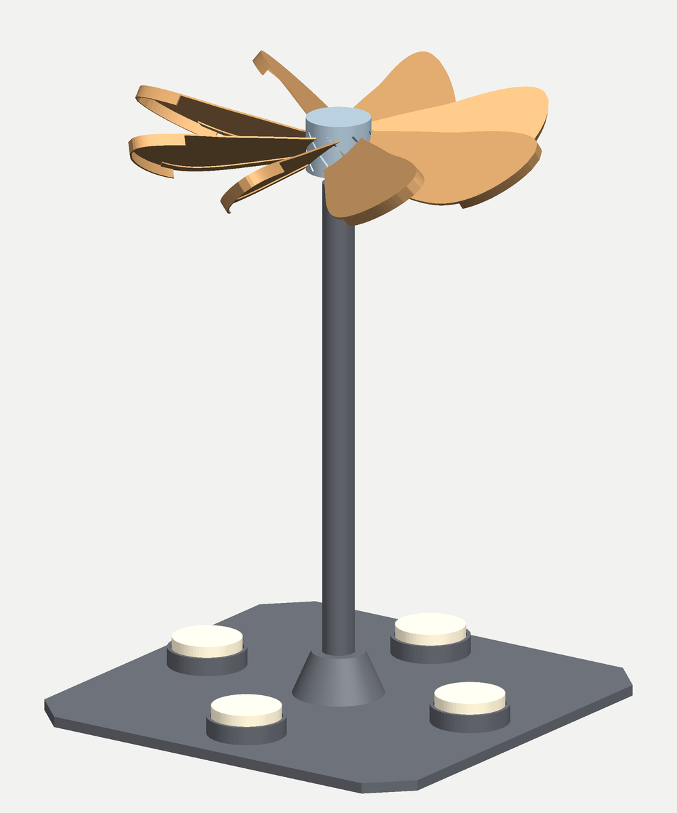
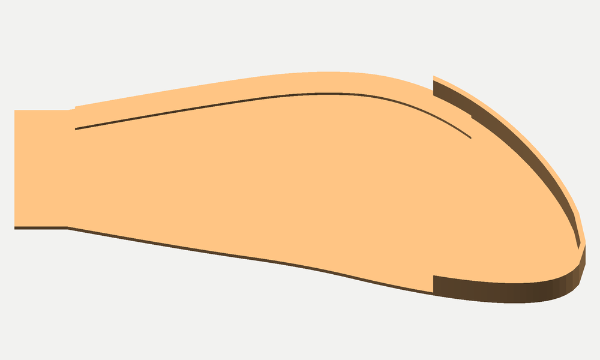
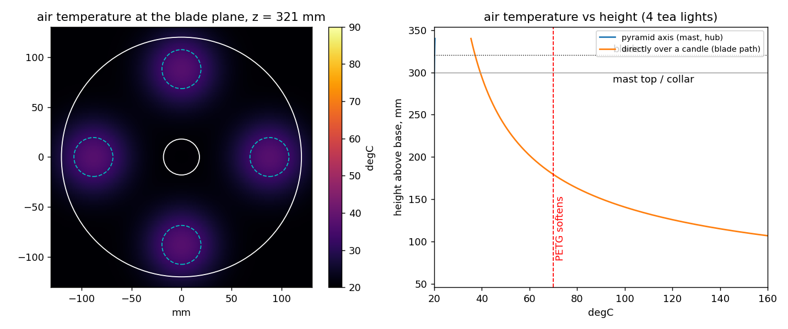

# Weihnachtspyramide — candle-driven carousel

A tabletop German Christmas pyramid: four tea lights heat the air, the warm air rises against
eight angled blades, the wheel turns. Parametric PETG print set for a 320 mm bed (Bambu H2S).

The physics is one line long: **heated air rises**. Candle → warm, less-dense air → upward flow →
torque on pitched blades → rotation. The paper spinner over a single tea light (a serrated disc on a
bead pivot) is the same machine; this build scales it up and puts it on a frame.

## Parts

Run `python pyramid.py` in this directory to regenerate everything. All parts verified watertight
after reload and inside 320 mm.

| part | qty | size (mm) | print | notes |
|---|---|---|---|---|
| `base_plate.stl` | 1 | 250 × 250 × 30 | flat | 15 % infill is plenty. Four tea-light rings; 30 mm deep through-socket for the mast inside a flared Ø52→Ø30 boss. Push-out hole under each cup doubles as an air gap |
| `mast.stl` | 1 | Ø18 × 300 | standing, brim | Central post, full section, passes right through the base and stands on the table. Ø6.25 socket in the top for the pin carrier |
| `pin_carrier.stl` | 1 | Ø10 × 15 | flange down | Ø1.6 bore for a **1.5 mm steel rod or a large sewing needle** |
| `pin_printed.stl` | 1 | Ø10 × 46 | point up, slow | All-printed fallback pin. Higher friction, still spins |
| `rotor_hub.stl` | 1 | Ø36 × 30 | flat | 15 % infill. Vee cup at the top of the bore, eight 40° slots |
| `blade.stl` | 8 | 112.5 × 54.5 × 6.9 | flat as exported, 100 % | 6.6 g each; slides 10.5 mm into its slot, drop of CA glue |

Solid masses: base 500 g, rotor 87 g (hub 34.5 g + 8 × 6.6 g). At 15 % infill the base is ~150 g and
the hub ~12 g.

### Blade geometry

The blade is a 1 mm plate with three features, all on the pressure face (the side the candles see),
so the STL prints flat with the features standing up and no supports:

- **Scimitar planform.** The chord grows to 52 mm at 60 % span, then the centreline sweeps 22 mm aft
  and the chord closes to a rounded point, like a falcon's primary feather. A swept, tapered tip puts
  less area at large radius (inertia scales with r²) and sheds its tip vortex progressively along the
  curve instead of all at once off a blunt end.
- **Tip fence.** A 1 mm × 6 mm wall follows the outer 30 mm of the outline. At blade Reynolds numbers
  around 1500 the pressure difference across a flat plate leaks around the tip freely; the fence
  blocks that spill so the outer, fastest-moving part of the blade keeps its load.
- **Leading-edge spar.** A 5 mm × 0.8 mm strip inside the leading edge from the hub to 80 % span. It
  stiffens the 1 mm plate against flutter and gives the leading edge a rounder entry.

`TIP_SWEEP`, `FENCE_*` and `SPAR_*` in `pyramid.py` set all three; set them to zero for the plain plate.

## Assembly

1. Push the mast down through the base until it stands on the table (30 mm of engagement, 0.35 mm
   clearance; a drop of glue if loose). `FRAME = "posts"`
   in `pyramid.py` swaps this for the classic four leaning posts plus an apex collar.
2. Cut a 1.5 mm steel rod to **43 mm**, or use a long sewing needle. **Do not leave it sharp**: round
   and polish the tip to a 0.3 mm dome (the sapphire-jewel stress argument in `plume-rotor` memory;
   here it also stops the pin drilling into a PETG cup). Push it into the pin carrier from the top so
   34 mm stands proud, then press the carrier into the top of the mast.
3. Slide the eight blades into the hub slots, same way round. Sit the hub on the pin.

The pin points up and the cup is in the rotor, compass-card style. The cup sits 26 mm up the hub and
the blades hang 13 mm below it, so the centre of mass is under the contact point and the rotor hangs
stable instead of leaning on the bore wall. The bore is Ø7 around a Ø1.5 pin: plenty of tilt room.
If you have a vee jewel (Ø4), the cup socket accepts it; otherwise the printed 90° vee is the cup.

## Why the blades are where they are

`python physics.py` runs a Heskestad plume estimate for four 40 W tea lights (28 W convective each)
and a blade-element torque balance. Blade plane is 269 mm above the flame tips (299 above the wax).

| blades above wax | peak air temp over a candle | starting torque | steady speed |
|---|---|---|---|
| 160 mm | 69 °C | 0.011 mN·m | stalls |
| 200 mm | 54 °C | 0.017 mN·m | 6 rpm |
| 240 mm | 45 °C | 0.025 mN·m | 12 rpm |
| **299 mm (built)** | **38 °C** | **0.038 mN·m** | **18 rpm** |
| 320 mm | 35 °C | 0.044 mN·m | 20 rpm |

Two things fall out of this:

- **Higher is better on both axes.** A rising plume gains momentum flux from buoyancy and widens, so
  a wheel at 300 mm intercepts more of it than a wheel at 160 mm, and the air is 30 K cooler. The
  bed height sets the ceiling, not the physics.
- **The blade path is the hot spot, not the axis.** At the blade plane the four plumes are still
  separate 70 mm wide columns over the candles. The hub and the mast sit between them at room
  temperature in this model. Blades sweep through 38 °C air, comfortably under PETG's ~70 °C
  softening point.

Caveats, in order of importance. Heskestad's correlation is for turbulent plumes; a candle plume is
laminar for its first 10–15 cm and hotter and narrower on axis than the correlation says. By 300 mm
it has transitioned and the estimate is about right, but **measure before leaving it unattended**:
an IR thermometer on the blades after 20 minutes should read well under 60 °C. Tea lights are 30–45 W
depending on brand. The torque model (flat plate, C_N = 1.6 sin α, laminar skin friction) is good to
maybe a factor of two; pivot friction at 0.012 mN·m is 3× under the starting torque, so it should
start on its own, and the spin-up time constant is ~16 s.

If it does not spin: lighter blades (`BLADE_T = 0.8`), a polished steel pin instead of the printed
one, candles moved inward to `R_CANDLE = 80` so the plumes hit mid-chord.

## Parameters that matter

All at the top of `pyramid.py`.

- `FRAME` — `"mast"` (one central post, default) or `"posts"` (four leaning posts + collar).
- `COLLAR_Z1` — mast top / frame height. `Z_APEX`, `R_POST_BASE`, `R_POST_TOP` set the four-post lean.
- `PITCH_DEG` — blade angle from horizontal. 40° is the traditional wheel. Lower pitch spins faster
  with less torque.
- `ROTOR_R`, `N_BLADE`, `ROOT_CHORD`, `TIP_CHORD`, `BLADE_T` — the wheel.
- `JEWEL_D` — socket for a real vee jewel if you fit one.

## Side study: can the hot air make a tone, and how low?

Two linear-onset scripts answer this with the Rayleigh criterion (Heckl / Matveev-Culick energy
balance: heat-release fluctuation vs. Stokes-layer wall loss plus open-end radiation, draft from a
chimney balance).

- `rijke_limit.py` — gauze heater (classic Rijke tube). Lighthill's 0.2 d/u lag for a 0.4 mm gauze
  is far too short to reproduce real tubes; the lag is calibrated to 0.71 ms against the textbook
  1 m / 150 W electrical tube. Onset power scales as f^-2.7: halving the pitch costs 6.5× the power.
  With 40–80 W absorbed by a gauze the floor is 150–200 Hz; 160 W fully captured gives 112 Hz (1.8 m
  tube); 30 Hz would need 5–10 kW.
- `singing_flame.py` — the flame itself as the heater (Higgins). A candle-class diffusion flame has a
  low-pass transfer function: the same time constant that lengthens its lag also kills its gain, and
  its phase passes π above ~75 Hz so it only drives long, lossy modes. Minimum onset is 500–1200 W
  wherever you put it — candles do not sing tubes, which matches experience. A gas-jet flame with an
  acoustically modulated feed (flat gain, pure delay of 3–5 ms) does: 160 W reaches 42–51 Hz in a
  4–5 m open-open tube, and 18–23 Hz in a 5–6 m quarter-wave tube (closed bottom with a small air
  inlet). That is the lowest tone this heat budget can drive, and it needs a gas flame, not candles.

Both models omit heater/flame-anchoring damping, mean-flow convection of acoustic energy, and
entropy-wave losses at the open end, all of which raise thresholds. Treat the numbers as floors.

## Files

- `pyramid.py` — generator, writes the STLs and `assembly.stl` (preview only, not a print).
- `preview.py` — renders `preview_*.png` with `lib/render_mesh`.
- `physics.py` — plume temperature and rotor speed estimate, writes `plume_temperature.png`.
